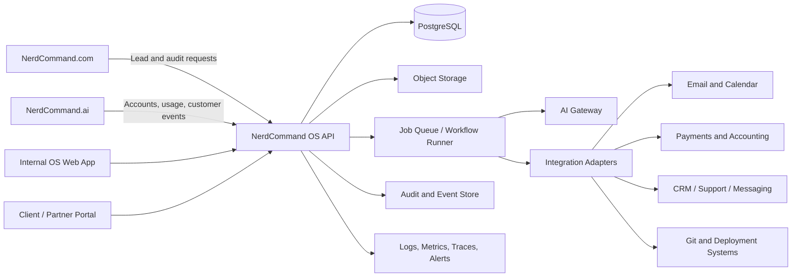

# NerdCommand CIO Blueprint v1

**Prepared:** July 14, 2026  
**Company:** NerdCommand, a GangsterNerds LLC company  
**Purpose:** Turn the current company concept, website outline, NerdCommand.ai product, and future Deckbreig codebase into one coherent operating model and technology roadmap.

---

## 1. Executive decision

NerdCommand should be organized as three connected systems with separate jobs:

1. **NerdCommand.com — the company and sales front door**  
   Explains what the company builds, establishes trust, generates qualified opportunities, and converts visitors into Command Audits or discovery calls.

2. **NerdCommand.ai — the customer product**  
   Hosts the existing AI product, customer workspaces, account onboarding, product usage, upgrades, and customer-facing tools.

3. **NerdCommand OS — the company operating system**  
   Runs NerdCommand's own sales, delivery, customer success, product work, finance visibility, knowledge, approvals, automations, and executive reporting. It may later expose selected portals or modules to customers.

These systems should share data through controlled APIs and events, but they should not be collapsed into one giant application or one unrestricted database.

### The core strategic idea

> **NerdCommand builds the systems that put a business under command—and NerdCommand OS proves the model by running NerdCommand itself.**

The first complete use case should be NerdCommand's own lead-to-customer-to-delivery workflow. That creates a real internal operating system, a repeatable implementation method, and a credible demonstration for customers.

---

## 2. What is already strong

The uploaded plan contains several strong foundations:

- The **command center** language is memorable and can unify the brand, product, and service experience.
- The hybrid model of **software plus implementation plus managed support** is more realistic for small-business AI adoption than selling an unconfigured tool alone.
- The proposed **AI Command Audit** is a good entry offer because it turns a vague AI conversation into a workflow diagnosis and a concrete next step.
- The trust-first position—human approval, logs, controls, and transparent usage—can become a meaningful market differentiator.
- The separation between the `.com` company site and the `.ai` product is directionally correct.

---

## 3. What must be corrected

### 3.1 Too many audiences at the front door

The current plan speaks equally to creators, local service businesses, agencies, consultants, and larger custom-software buyers. That makes the company sound broad before it has established proof.

**Recommended beachhead:** service businesses and agencies that receive inbound leads, have multiple disconnected tools, and lose money through slow follow-up or inconsistent delivery.

Creators can remain a NerdCommand.ai product audience, but they should not dominate the NerdCommand.com homepage.

### 3.2 Too many offers presented as equal

Use a simple offer ladder:

1. **Command Audit** — diagnose workflows and produce a Command Map.
2. **Command Implementation** — install a defined workflow package.
3. **Managed Command Operations** — monitoring, optimization, support, and reporting.
4. **Custom Software Build** — deeper applications and integrations.
5. **NerdCommand.ai** — self-serve or product-led entry point.

The homepage should not make visitors choose among six unrelated services.

### 3.3 Pricing is still a hypothesis

The setup and monthly amounts in the uploaded plan are useful internal targets, but they should not be treated as validated pricing until delivery effort, support burden, AI usage, integration complexity, and customer willingness to pay have been measured.

Use “starting at” pricing or request-a-scope language during the first repeatable implementations. Maintain an internal cost model for every package.

### 3.4 “Run the whole company” cannot mean “one giant monolith”

A company operating system should provide one coordinated experience, not one tightly coupled codebase that owns every business function. Accounting, payments, identity, email delivery, and other specialized functions should usually remain in trusted systems of record and be connected through integrations.

NerdCommand OS should be the **control plane and operational source of truth** for decisions, ownership, status, approvals, and cross-system reporting.

---

## 4. Brand and product architecture

| Property | Primary role | Primary audience | Main conversion |
|---|---|---|---|
| `nerdcommand.com` | Company website, authority, education, sales | Business owners, agency partners, software buyers | Command Audit / discovery request |
| `nerdcommand.ai` | Product marketing, signup, application | Product users and customer teams | Account creation / product upgrade |
| `os.nerdcommand.com` or `command.nerdcommand.com` | Internal operating system and selected client portals | NerdCommand team; later customers/partners | Authenticated work |
| `docs.nerdcommand.com` | Product and implementation documentation | Customers, partners, developers | Successful adoption |
| `status.nerdcommand.com` | Service-health communication | Customers | Trust and incident visibility |

Only the first three are needed for the initial operating model. Documentation and status properties can be introduced when the product and customer base justify them.

---

## 5. NerdCommand OS product definition

### Mission

NerdCommand OS gives every person, customer, project, workflow, and decision a clear owner, current status, next action, approval history, and measurable outcome.

### Core object: the Command

The differentiating object should be a **Command**, not merely a generic task.

A Command contains:

- Intent: what outcome is required.
- Owner: who is accountable.
- Context: linked customer, opportunity, project, document, or metric.
- State: proposed, awaiting approval, active, blocked, completed, failed, or canceled.
- Priority and due date.
- Next action.
- Automation policy: human-only, AI-assisted, approval-required, or preauthorized.
- Evidence: notes, files, messages, generated outputs, and execution logs.
- Outcome: result, metric movement, cost, and lessons learned.

Agents can **propose** Commands. Authorized humans approve sensitive Commands. The system executes permitted actions and records the result.

### Design principles

- **One command surface, multiple systems of record.**
- **Human accountability remains visible.**
- **Every automated action is attributable and reversible where possible.**
- **Tenant and customer data are isolated.**
- **Build a modular monolith first; split services only when real scale or risk requires it.**
- **The first customer is NerdCommand itself.**
- **No automation without monitoring, ownership, and a failure path.**

---

## 6. Functional map

### A. Executive Command

- Today view: revenue, pipeline, delivery risk, support risk, cash indicators, product health.
- Executive brief generated from verified system data.
- Decisions and approvals queue.
- Company scorecard and operating goals.
- Alerts requiring human attention.

### B. Revenue Command

- Lead capture from NerdCommand.com and partner sources.
- Contact and organization records.
- Qualification, Command Audit scheduling, opportunities, proposals, and contracts.
- Pipeline stages, values, probability, owner, and next action.
- Referral and partner attribution.
- Follow-up drafting with approval controls.

### C. Client Command

- Customer profile and relationship history.
- Onboarding plan.
- Active services, subscriptions, environments, and integrations.
- Customer health, open risks, support history, and renewal dates.
- Secure client portal for selected information and approvals.

### D. Delivery Command

- Projects, milestones, Commands, dependencies, blockers, and acceptance criteria.
- Implementation templates by package.
- Change requests and scope decisions.
- Deployment checklist and launch record.
- Time, cost, quality, and margin visibility.

### E. Product Command

- Product roadmap, requirements, releases, bugs, incidents, and feature requests.
- Git repository and deployment links.
- Usage, reliability, AI cost, and customer-feedback signals.
- Release approvals and rollback information.

### F. Marketing Command

- Content calendar and campaign briefs.
- Source assets, approvals, publishing status, and performance.
- Case-study pipeline.
- Attribution from campaign to lead to opportunity to revenue.
- Brand and message library.

### G. Finance Command

- Contract value, invoice status, recurring revenue, expenses, delivery cost, and gross-margin view.
- Payment and accounting integrations rather than reimplementing a full accounting ledger.
- Forecast and collections alerts.
- AI and infrastructure cost allocation by customer/workspace.

### H. Knowledge Command

- Standard operating procedures.
- Product documentation.
- Customer implementation notes.
- Approved prompts and reusable workflow templates.
- Decision records and lessons learned.
- Permissions and document lifecycle.

### I. Automation and Agent Command

- Agent registry and purpose.
- Tool permissions.
- Prompt and policy versions.
- Workflow definitions.
- Run history, cost, latency, errors, and human interventions.
- Approval queues, retry controls, kill switches, and budget limits.

### J. Administration and Trust

- Users, organizations, workspaces, roles, and permissions.
- Integration credentials stored in a secure secret system.
- Audit trail.
- Data retention and deletion policies.
- Security events and incident procedures.
- Backup and recovery status.

---

## 7. Primary user experience

### Navigation model

**Left rail**

- Overview
- Revenue
- Clients
- Delivery
- Product
- Marketing
- Finance
- Knowledge
- Automations
- Administration

**Top bar**

- Universal search
- Command palette
- Create Command
- Approvals
- Alerts
- Workspace switcher
- User/account controls

### Home screen

The first screen should answer five questions:

1. What requires attention now?
2. What is at risk?
3. What is generating or blocking revenue?
4. What approvals are waiting?
5. What changed since the last review?

Recommended panels:

- Attention queue
- Pipeline snapshot
- Delivery health
- Customer health
- Product/automation incidents
- Cash and collections indicators
- Recent decisions
- Daily Command Brief

### Record pattern

Every lead, client, project, case, campaign, and workflow should use a consistent record layout:

- Summary
- Owner and status
- Next action
- Timeline/activity
- Related Commands
- Documents
- Communications
- Metrics
- Automations
- Audit history

---

## 8. First end-to-end workflow

The first workflow to implement should be **lead to recurring customer**:

1. Visitor submits a Command Audit request on NerdCommand.com.
2. NerdCommand OS creates or matches the contact and organization.
3. The system records source and consent information.
4. AI summarizes the request and proposes a qualification score.
5. A human reviews the lead and chooses the next action.
6. The system schedules and prepares the audit.
7. Audit notes generate a draft Command Map and proposal.
8. A human approves the customer-facing documents.
9. A signed engagement creates the client workspace, project, implementation Commands, and billing setup.
10. Delivery follows a reusable package template.
11. Launch creates monitoring, support, success, and renewal Commands.
12. Executive reporting tracks revenue, delivery margin, product usage, and customer health.

This workflow becomes both the company's operating backbone and its best live demonstration.

---

## 9. Technical architecture

### Recommended starting shape

Use a **modular monolith with an API boundary and an event/outbox pattern**. This provides faster development and simpler operations while preserving clean module ownership.

### Application layers

1. **Web applications**  
   Public site, internal OS, and selected client/partner portals.

2. **API and application services**  
   Stable interfaces for each domain module and external property.

3. **Domain modules**  
   Identity, organizations, contacts, revenue, clients, delivery, product, finance views, knowledge, automations, approvals, and audit.

4. **Workflow execution**  
   Durable background jobs, scheduled work, retries, timeouts, failure queues, and human approval waits.

5. **AI gateway**  
   Provider abstraction, model policy, prompt versions, redaction, usage/cost tracking, evaluations, and fallback behavior.

6. **Integration adapters**  
   Isolate third-party APIs behind NerdCommand-owned contracts.

7. **Data and files**  
   Relational system of record for operational data; object storage for files; search/index capability when needed.

8. **Observability and security**  
   Logs, metrics, traces, alerts, audit records, secret management, backups, and recovery tests.

### Do not begin with

- A large fleet of microservices.
- Unrestricted autonomous agents.
- A custom accounting ledger.
- Direct third-party API calls scattered through UI components.
- One shared administrator role for every person.
- Customer data mixed with internal company data without tenant boundaries.
- A rewrite of Deckbreig before its reusable parts are understood.

---

## 10. Minimum data model

### Identity and tenancy

- User
- Organization
- Workspace
- Membership
- Role
- Permission
- ServiceAccount / AgentIdentity

### Revenue and clients

- Person / Contact
- Company / Account
- Lead
- Opportunity
- Activity
- Audit
- Proposal
- Contract
- Subscription / ServiceAgreement

### Work

- Command
- Project
- Milestone
- Deliverable
- Dependency
- Risk
- Decision
- Approval
- Comment
- Attachment

### Product and support

- Product
- Environment
- Deployment
- Incident
- FeatureRequest
- SupportCase
- CustomerHealthSnapshot

### Automation

- Agent
- ToolPolicy
- WorkflowDefinition
- WorkflowVersion
- WorkflowRun
- StepRun
- PromptVersion
- ModelUsage
- IntegrationConnection

### Governance

- AuditEvent
- ConsentRecord
- DataRetentionRule
- SecurityEvent
- Notification

The schema should use stable identifiers, timestamps, owner fields, workspace boundaries, and append-only audit records for important actions.

---

## 11. Roles and permissions

Initial roles may include:

- Owner / Executive
- Administrator
- Sales Operator
- Delivery Operator
- Product Operator
- Finance Viewer or Operator
- Support Operator
- Partner
- Client Administrator
- Client Member
- Agent / Service Account

Permissions should be capability-based rather than relying only on job titles. Sensitive actions—sending external communications, changing billing, exporting data, deleting records, deploying software, or granting access—need explicit authorization and audit evidence.

---

## 12. AI governance requirements

Every agent or AI-assisted workflow needs:

- A named business owner.
- A defined purpose and allowed data.
- An approved tool list.
- A model and prompt version.
- Cost and rate limits.
- Input/output logging appropriate to the data classification.
- Tests and evaluation criteria.
- A human approval rule for external or high-impact actions.
- Timeout, retry, and failure behavior.
- A kill switch.
- A review date.

### Suggested automation levels

| Level | Behavior | Example |
|---|---|---|
| 0 | Human-only | Contract approval |
| 1 | AI recommends | Lead qualification suggestion |
| 2 | AI drafts, human approves | Customer email or proposal |
| 3 | AI executes within policy | Internal categorization or data sync |
| 4 | Preauthorized autonomous loop with monitoring | Low-risk health checks and alerts |

External communications, financial actions, permission changes, data deletion, and production deployments should not begin at Level 4.

---

## 13. Deckbreig adaptation strategy

Do not rename the repository and start adding modules immediately. First determine what Deckbreig actually is architecturally.

### Repository review gates

1. **Bootability**  
   Can the application run from documented steps in a clean environment?

2. **Architecture inventory**  
   Frameworks, runtime, database, authentication, APIs, background jobs, integrations, file storage, deployment, tests, and observability.

3. **Domain inventory**  
   Current users, organizations, permissions, records, workflows, and business assumptions.

4. **Quality and risk inventory**  
   Secrets, dependency risk, missing tests, data migration risk, security flaws, dead code, and deployment gaps.

5. **Reuse classification**  
   - Keep as-is
   - Refactor behind an interface
   - Convert into a NerdCommand OS module
   - Replace
   - Archive

6. **Migration design**  
   Introduce organization/workspace boundaries, role-based access, Command/Approval/Audit objects, API contracts, and migration scripts without destroying useful history.

7. **Visual and naming conversion**  
   Apply the NerdCommand design system and product language after the underlying boundaries are sound.

### Likely first platform capabilities to add

- Organization and workspace tenancy
- Role-based access control
- Global navigation shell and command palette
- Command, approval, and audit records
- Integration layer
- Background workflow runner
- AI gateway and usage ledger
- Operational dashboard
- Production monitoring and backup procedures

### Repository intake package

When the repository is provided, include:

- Repository URL or archive and the branch to review
- README and local setup instructions
- `.env.example` with no real secrets
- Database schema and migrations
- Test instructions
- Deployment configuration
- Screenshots or a walkthrough of current behavior
- Known issues and intended users
- A note identifying code or services that must remain unchanged

Never send production keys, personal access tokens, customer data, or unredacted secrets.

---

## 14. NerdCommand.com website strategy

### Primary job

Convert qualified business visitors into Command Audits or scoped software conversations. It should not attempt to duplicate the entire NerdCommand.ai product site.

### Recommended navigation

- Solutions
- NerdCommand OS
- Services
- Work
- Company
- Resources
- Book a Command Audit
- Login

“Login” can route to the appropriate product or portal. “Creators” can live under NerdCommand.ai rather than occupying a top-level `.com` navigation item.

### Homepage structure

1. **Hero**
   - Headline: **Build smarter systems. Run your business under command.**
   - Supporting copy: **NerdCommand designs and deploys AI-powered software, workflows, and command centers that turn scattered operations into controlled, measurable systems.**
   - Primary CTA: **Request a Command Audit**
   - Secondary CTA: **Explore What We Build**

2. **Credibility strip**
   - Industries served, trusted technology categories, partner badges, or real customer proof when available.
   - Do not manufacture logos, metrics, testimonials, or case studies.

3. **The operating problem**
   - Leads are missed.
   - Work is spread across disconnected tools.
   - Owners lack a reliable daily picture.
   - AI experiments do not become controlled operations.

4. **What NerdCommand builds**
   - AI workflow implementations
   - Internal command centers and dashboards
   - Customer and team portals
   - Custom software and integrations
   - Managed optimization and support

5. **NerdCommand OS demonstration**
   - Show the Command Brief, approvals, lead-to-delivery flow, and automation health.
   - Use real screenshots after the Deckbreig conversion begins.

6. **How an engagement works**
   - Command Audit
   - Command Map
   - Build and integration
   - Launch and training
   - Managed optimization

7. **Solutions by outcome**
   - Capture and convert revenue
   - Onboard and serve customers
   - Control delivery and projects
   - Understand company performance

8. **Proof**
   - Case studies, process evidence, demo videos, security practices, and customer statements.

9. **Trust section**
   - Human approvals
   - Role-based access
   - Audit trails
   - Data boundaries
   - Monitoring and support

10. **Final CTA**
   - Request a Command Audit

### Supporting pages

- `/solutions/revenue-operations`
- `/solutions/client-delivery`
- `/solutions/company-intelligence`
- `/nerdcommand-os`
- `/services`
- `/work`
- `/company`
- `/resources`
- `/command-audit`
- `/partners` when the partner motion is ready

---

## 15. Website visual direction

The design should feel like an **executive mission-control system**, not a generic AI landing page and not a movie-style hacker interface.

### Visual language

- Dark graphite or near-black foundation balanced by warm light sections.
- One high-energy command accent used sparingly.
- Strong grid, generous spacing, clear hierarchy, and precise status indicators.
- Geometric display typography paired with a highly readable interface typeface.
- Real interface panels, system maps, event streams, and operational diagrams.
- Cultural confidence expressed through voice, photography, illustration, and editorial choices—not through visual clutter.

### Interaction language

- Command-palette motif.
- Smooth but restrained transitions.
- Status changes and workflow movement as the primary animation concept.
- Clear focus states and keyboard navigation.
- Mobile-first conversion path.
- Fast pages and reduced-motion support.

### Brand voice

- Direct
- Intelligent
- Operator-focused
- Confident without exaggerated claims
- Culturally grounded
- Trustworthy about what AI can and cannot do

---

## 16. Review of the uploaded HTML

The HTML is a useful content prototype, not a production website.

### Good elements

- Clear hero and call to action.
- Logical sections.
- Basic responsive column behavior.
- Plain-language service descriptions.
- Correct separation of business implementation and the NerdCommand.ai product.

### Production gaps

- The form uses `action="#"`, so it does not create a lead or send a notification.
- There is no validated server-side form processing, spam protection, consent handling, or failure state.
- Styling is embedded and does not form a maintainable design system.
- There is no production navigation behavior for mobile users.
- There are no proof assets, case studies, or real product screenshots.
- The page lacks a complete SEO and social-sharing implementation.
- There is no analytics and attribution plan tied to the CRM.
- There are no privacy, terms, accessibility, security, or data-handling pages.
- The packages are presented before their delivery economics and scope are validated.
- The creator offer receives too much homepage weight for a `.com` site intended to sell B2B software and implementation.
- The page does not yet communicate why NerdCommand is different from an agency, automation consultant, generic chatbot builder, or SaaS tool.

### Required production capabilities

- Semantic page landmarks, skip navigation, accessible labels, focus states, and contrast testing.
- Separate design tokens and component styles.
- Secure form endpoint integrated with NerdCommand OS.
- Source attribution and campaign parameters.
- Confirmation, error, and retry experiences.
- Structured metadata, canonical URLs, social preview images, sitemap, and robots configuration.
- Performance budgets and optimized images.
- Security headers and dependency review.
- Privacy and consent records appropriate to the tools used.
- Real deployment environments and rollback process.

---

## 17. Metrics that should appear in NerdCommand OS

### Company

- Qualified pipeline
- Contracted recurring revenue
- Collected revenue
- Gross margin by service/package
- Cash and collections alerts

### Sales

- New qualified leads
- Median first-response time
- Audit booking rate
- Audit-to-proposal rate
- Proposal-to-close rate
- Sales cycle and source attribution

### Delivery

- Time to first value
- Milestone predictability
- Open blockers and risks
- Change-request volume
- Delivery cost versus budget
- Acceptance and rework rate

### Product and automation

- Active organizations and users
- Successful workflow runs
- Human intervention rate
- Approval turnaround
- Failure and retry rate
- AI/infrastructure cost per successful outcome
- Incident count and recovery time

### Customer success

- Onboarding completion
- Product/workflow adoption
- Open support risk
- Customer health
- Renewal and expansion pipeline

Metrics should be tied to definitions and source data. Avoid decorative dashboard numbers that no one owns or acts upon.

---

## 18. Release gates

### Gate 0 — Company architecture approved

- Brand/property roles agreed.
- Primary target customer agreed.
- Offer ladder agreed.
- Sensitive-data and automation rules agreed.

### Gate 1 — Deckbreig technical assessment complete

- Application runs locally.
- Architecture and data model documented.
- Security and quality risks ranked.
- Reuse/refactor/replace decisions recorded.

### Gate 2 — NerdCommand OS foundation usable internally

- Authentication and roles.
- Organization/workspace model.
- Command, approval, and audit capabilities.
- Executive overview.
- Lead intake from a test form.
- Monitoring, backup, and recovery basics.

### Gate 3 — Lead-to-customer workflow operational

- Command Audit intake.
- Qualification and follow-up.
- Proposal/contract handoff.
- Client/project creation.
- Delivery template.
- Billing integration.
- Customer-success handoff.

### Gate 4 — Production website connected

- Real brand design and copy.
- Secure conversion forms.
- Attribution and analytics.
- Proof content.
- Accessibility, SEO, privacy, and security review.

### Gate 5 — Managed customer implementation repeatable

- Standard package scope.
- Onboarding checklist.
- Integration and deployment playbooks.
- Support and incident model.
- Margin and usage reporting.
- Case-study evidence.

### Gate 6 — Selected customer-facing OS modules

- Tenant isolation verified.
- Client roles and permissions.
- Customer portal.
- Workflow templates.
- Usage and billing controls.
- Supportability and documentation.

---

## 19. Immediate CIO directives

1. Treat the uploaded HTML as a wireframe, not the final build.
2. Make NerdCommand.com a focused B2B sales site; send product users to NerdCommand.ai.
3. Define NerdCommand OS as the internal control plane and dogfood it before selling it broadly.
4. Build the lead-to-delivery workflow before attempting every department module.
5. Keep specialized systems of record where they are strong; integrate them rather than recreating them.
6. Do not rewrite or rename Deckbreig until the repository audit classifies what is reusable.
7. Put permissions, approvals, audit logs, cost controls, and failure handling into the foundation—not a later security phase.
8. Validate package scope and economics with real implementations before locking public pricing.
9. Capture real proof from NerdCommand's own use of the OS.
10. Maintain one written architecture decision log so the system does not become a collection of disconnected ideas.

---

## 20. One-sentence operating model

> **NerdCommand.com wins and qualifies the work; NerdCommand.ai delivers the product experience; NerdCommand OS controls how the company sells, builds, serves, learns, and scales.**
